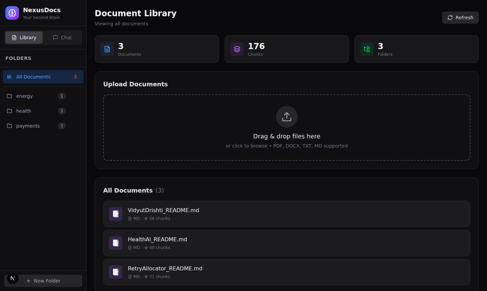
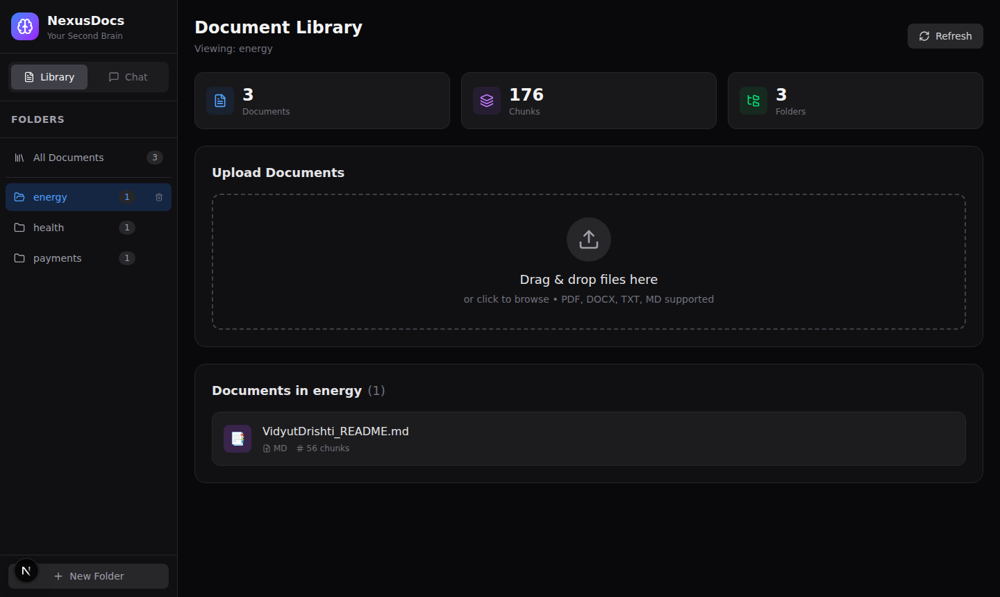
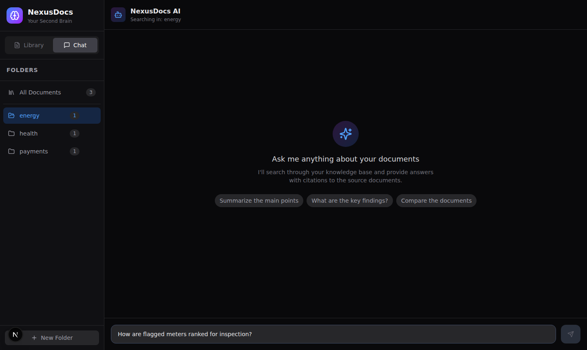
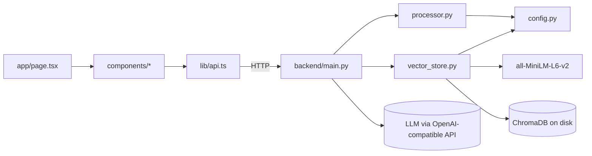
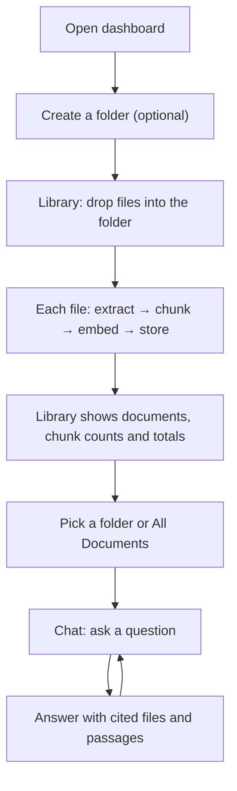
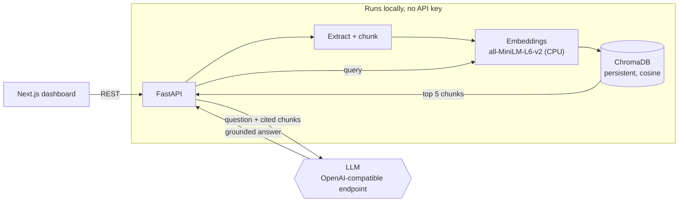

# NexusDocs

**Upload PDFs, Word files, text and Markdown, sort them into folders, and ask questions in plain English. Answers come only from your documents, with the source file and passage cited under each one.** Retrieval runs locally (sentence-transformer embeddings in ChromaDB); only the final answer-writing step calls a language model.

> A personal project. Single user, no authentication, runs on your own machine. See [Limits](#limits).

**Contents:** [Problem](#problem-statement) · [Solution](#solution) · [Screenshots](#screenshots) · [File structure](#file-structure) · [User flow](#user-flow) · [LLD](#low-level-design-lld) · [HLD](#high-level-design-hld) · [Scaling](#how-it-would-scale) · [USP](#usp-what-is-different) · [Tools](#tools-and-software-used) · [Principles](#principles-used) · [Requirements](#functional-and-non-functional-requirements) · [Results](#results) · [Run it](#run-it) · [Limits](#limits)

## Problem statement

Notes, papers, project docs and course material end up spread across folders and formats. Finding one answer means remembering which file it was in and searching each one. Pasting everything into a chatbot has two problems:

- **It can't be checked.** The answer may come from the model's training data rather than your documents, and there is no pointer to where it came from.
- **It mixes contexts.** Ask about "results" and you get a blend of every project you have ever uploaded.

So the requirements are:

1. **Answer only from the uploaded documents**, and say so when they don't contain the answer.
2. **Cite the file and passage** behind every answer, so it can be verified in seconds.
3. **Let the user scope a question to one folder**, so unrelated documents don't leak in.

## Solution

1. **Upload.** Drag and drop `.pdf`, `.docx`, `.txt` or `.md` into a folder.
2. **Extract.** pypdf for PDFs, python-docx for Word, plain read for text and Markdown.
3. **Chunk.** Recursive character splitting into 1,000-character chunks with 200 characters of overlap, breaking on paragraphs, then lines, then sentences.
4. **Embed locally.** `all-MiniLM-L6-v2` (sentence-transformers, normalised, CPU). No API key is needed to index or search.
5. **Store.** Each chunk goes into a persistent ChromaDB collection (cosine HNSW) with its document id, file name, folder and chunk index.
6. **Retrieve.** A question is embedded the same way and the 5 nearest chunks are fetched, filtered to the selected folder if one is chosen.
7. **Answer.** The chunks are passed to the model labelled `[Source n: filename]`, with instructions to use only that context, cite the file and say when the context is not enough. Temperature 0.2.
8. **Cite.** The response lists each source file once, with its best-matching passage (first 200 characters) and a relevance score (1 − cosine distance).

## Screenshots

Captured from a local run of this repository with three of my other project READMEs uploaded into three folders.





## File structure

```text
Nexus_Docs/
├── backend/
│   ├── main.py            FastAPI app: request/response models, RAG engine (prompt + LLM call), all endpoints, CORS
│   ├── processor.py       Text extraction per file type, chunking, deterministic document ids
│   ├── vector_store.py    ChromaDB client, local embeddings, add/delete/search, folder and stats queries
│   ├── config.py          Paths, model names, chunk size and overlap, supported extensions (from .env)
│   ├── requirements.txt   Python dependencies (UTF-16 encoded; pip reads it fine)
│   └── .env.example       Environment template
└── frontend/              Next.js 16, React 19, Tailwind CSS 4
    └── src/
        ├── app/page.tsx           Dashboard: sidebar, Library and Chat tabs, folder selection
        ├── components/
        │   ├── FileUpload.tsx     Drag-and-drop upload (react-dropzone) into the selected folder
        │   ├── DocumentList.tsx   Documents with type and chunk count, delete
        │   ├── FolderSidebar.tsx  Folders with document counts, create and delete
        │   ├── ChatInterface.tsx  Questions, answers, expandable citations
        │   └── StatsDisplay.tsx   Document, chunk and folder totals
        └── lib/
            ├── api.ts             Typed client for every backend endpoint (NEXT_PUBLIC_API_URL)
            └── types.ts           Shared request and response types
```

### How the files connect



## User flow



**Explanation.** A user builds a library once, folder by folder, then asks questions against everything or one folder at a time. Each answer shows which files it drew on, so the user can open the passage and check it.

## Low-level design (LLD)

**Indexing a file** (`POST /upload`):

| Step | Detail |
|---|---|
| Validate | Extension must be one of `.pdf .docx .txt .md`, otherwise 400 |
| Save | `uploads/<folder>/<filename>` |
| Id | `doc_id = md5("<folder>/<filename>")[:12]`, so the same file in the same folder always gets the same id |
| Chunk | `RecursiveCharacterTextSplitter(1000, 200, ["\n\n", "\n", ". ", " ", ""])` |
| Embed and store | Chunk ids `<doc_id>_<i>`; metadata `doc_id, filename, folder, file_type, chunk_index, total_chunks` |
| Failure | The saved file is removed and the error is returned as 500 |

**Answering a question** (`POST /chat`):

| Step | Detail |
|---|---|
| Retrieve | Embed the query, top 5 by cosine distance, `where={"folder": ...}` when scoped |
| Empty | No chunks found → a fixed "couldn't find relevant information" reply, no model call |
| Prompt | System rules: use only the context, cite the source file, say when information is missing, never invent |
| Generate | `ChatOpenAI` against an OpenAI-compatible endpoint (OpenRouter by default), `temperature=0.2` |
| Citations | One per file, the best-scoring chunk, sorted by relevance |

**API**

| Method | Endpoint | Purpose |
|---|---|---|
| GET | `/` | Health check |
| GET | `/stats` | Document, chunk and folder totals |
| POST | `/upload` | Upload and index a file (`file`, `folder` form fields) |
| GET | `/documents?folder=` | List documents, optionally in one folder |
| DELETE | `/documents/{doc_id}` | Remove a document's chunks and file |
| GET | `/folders` | Folders with document counts |
| POST | `/folders/{name}` | Create a folder |
| DELETE | `/folders/{name}` | Delete a folder and everything in it |
| POST | `/chat` | `{"query": "...", "folder": "optional"}` → answer and citations |

## High-level design (HLD)



**Explanation.** Indexing and search never leave the machine. Only the question and the 5 retrieved chunks are sent to the model, which writes the answer. Swapping the model is a change to `OPENAI_BASE_URL` and `OPENAI_MODEL` in `.env`.

## How it would scale

| Concern | Today | Next step |
|---|---|---|
| Users | Single user, no auth, one shared collection | Auth plus a collection or metadata filter per user |
| Ingestion | Synchronous in the upload request | Background queue so large PDFs don't block the request |
| Retrieval | Pure vector top 5 | Hybrid search (BM25 + vectors) and a re-ranker, which helps exact terms like names and numbers |
| Storage | Local ChromaDB folder | Managed vector database (pgvector, Qdrant) |
| Answers | Whole answer returned at once | Stream tokens to the UI |
| Quality | One manual retrieval check | A saved question set with expected sources, run in CI |

## USP: what is different

| Feature | Common approach | What this does |
|---|---|---|
| Grounding | Model answers from anything it knows | Answers only from retrieved chunks, and says when they are not enough |
| Verifiability | Answer only | Every answer lists source files with the matching passage and a relevance score |
| Context control | One big pile of documents | Folder scoping applied at retrieval time |
| Cost and privacy | Paid embedding API for every chunk | Local embeddings; only the final question and 5 chunks reach the model |
| Model choice | Locked to one provider | Any OpenAI-compatible endpoint via `.env` |

## Tools and software used

| Tool | Used for | Why this one |
|---|---|---|
| **FastAPI, Pydantic** | REST API, request and response models | Typed, async, automatic docs at `/docs` |
| **LangChain** | Text splitter, embeddings wrapper, chat model client | Standard building blocks for a RAG pipeline |
| **sentence-transformers (`all-MiniLM-L6-v2`)** | Embeddings | Small, fast on CPU, free, no key |
| **ChromaDB** | Vector store | Embedded, persistent, metadata filters for folders |
| **pypdf, python-docx** | Text extraction | Pure Python, no system dependencies |
| **OpenRouter (OpenAI-compatible)** | Answer generation | One key for many models; swappable |
| **Next.js, React, TypeScript, Tailwind CSS** | Dashboard | Typed UI, fast iteration |
| **react-dropzone, lucide-react** | Upload, icons | Small, well-known components |

## Principles used

* **Retrieve locally, generate remotely.** The expensive, private part (reading every document) stays on the machine.
* **Ground every answer.** The prompt forbids outside knowledge and the response always carries its sources.
* **Scope before you search.** Folder filters are applied inside the vector query, not after it.
* **Deterministic ids.** The same file in the same folder always maps to the same document id.
* **Clean up on failure.** A file that fails to index is deleted rather than left half-processed.

## Functional and non-functional requirements

**Functional**

| Requirement | How it is implemented |
|---|---|
| Upload 4 file types | `processor.py` extractors, extension check in `/upload` |
| Organise in folders | Folder metadata on every chunk; folder endpoints |
| Ask questions | `/chat`, retrieval plus grounded prompt |
| Cite sources | Deduplicated citations with passage and score |
| Scope to a folder | Chroma `where` filter |
| Manage the library | List, delete document, delete folder, stats |

**Non-functional**

| Quality | How it is handled |
|---|---|
| Privacy | Documents and embeddings stay local; only question + 5 chunks go to the model |
| Cost | Indexing and search are free (CPU embeddings) |
| Latency | Vector search measured at about 33 ms median on 2 CPU cores for 176 chunks |
| Portability | Model and endpoint set in `.env`; any OpenAI-compatible API works |
| Persistence | ChromaDB on disk survives restarts |

## Results

A quick retrieval check, run once on this code (not a committed eval): three of my project READMEs indexed into three folders (176 chunks), then 10 questions whose answers sit in exactly one of the three files, searched across **all** folders.

| What | Result |
|---|---|
| Right document ranked first | **9 / 10** |
| Right document anywhere in the top 5 | **10 / 10** |
| Search time (embed query + top 5), median | **33 ms** on 2 CPU cores |
| The miss | "What is the peak window where retries are not allowed?" ranked a health document first; the payments document was still in the top 5 |

The answer-writing step needs an API key, so answer quality was not measured here.

## Run it

**Backend**

```bash
cd backend
python -m venv venv && source venv/bin/activate          # Windows: venv\Scripts\activate
pip install -r requirements.txt
cp .env.example .env                                      # then set OPENAI_API_KEY
uvicorn main:app --reload --port 8000                     # API docs at http://localhost:8000/docs
```

The first run downloads the `all-MiniLM-L6-v2` model (about 90 MB). Uploading and searching work without a key; only `/chat` needs one.

**Frontend**

```bash
cd frontend
npm install
npm run dev                                               # http://localhost:3000
```

| Environment variable | Default | Purpose |
|---|---|---|
| `OPENAI_API_KEY` | none | Key for the answer model (required for chat) |
| `OPENAI_BASE_URL` | `https://openrouter.ai/api/v1` | Any OpenAI-compatible endpoint |
| `OPENAI_MODEL` | `openai/gpt-4o-mini` | Model that writes answers |
| `CHROMA_PERSIST_DIR` | `backend/chroma_db` | Vector store location |
| `UPLOAD_DIR` | `backend/uploads` | Uploaded files |
| `NEXT_PUBLIC_API_URL` | `http://localhost:8000` | Backend URL for the frontend |

## Limits

- **No authentication**, one shared library, CORS open to `localhost:3000` only. Meant to run on your own machine.
- **Folder and file names are not sanitised** before being used in paths, so it should not be exposed to untrusted users.
- **Re-uploading an edited file** with the same name into the same folder keeps the old chunks: it gets the same document id and ChromaDB skips ids it already has. Delete the old copy first.
- **Empty folders don't persist in the sidebar.** Folders are read from chunk metadata, so a new folder only shows up once it holds a document.
- **Chat without a key fails** with a 500 rather than falling back to showing the retrieved passages.
- **Scanned PDFs** have no text layer, so the upload is rejected with "No text content extracted"; there is no OCR.
- **No automated tests**, and the retrieval check above is one manual run on 10 questions, not a benchmark.
- `EMBEDDING_MODEL` in `config.py` is not used; the embedding model is set in `vector_store.py`.
